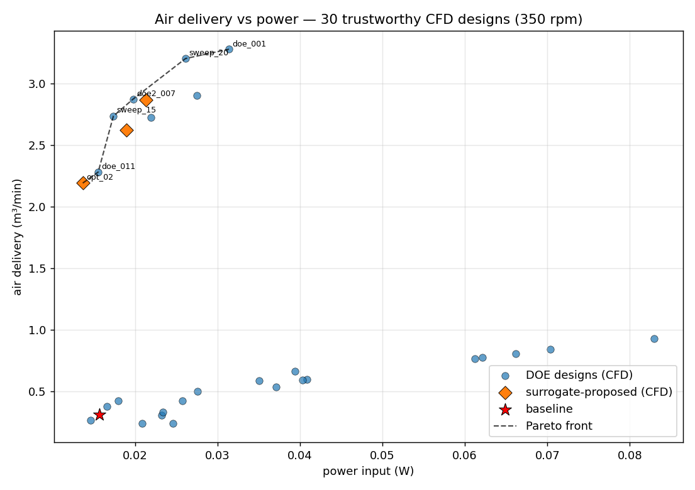
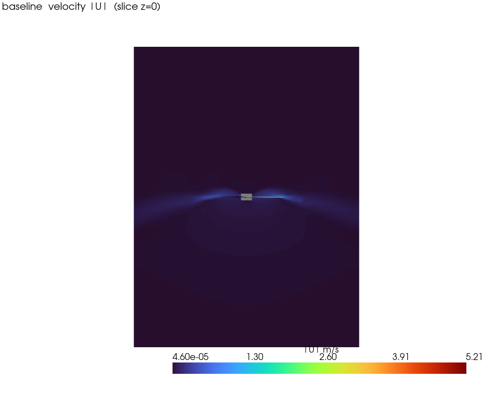
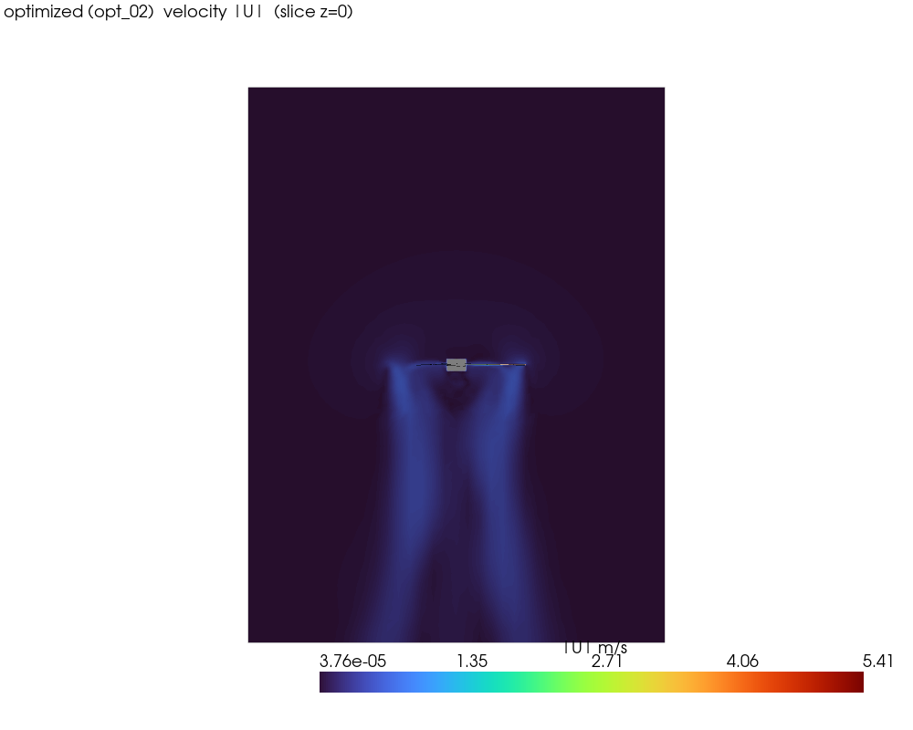
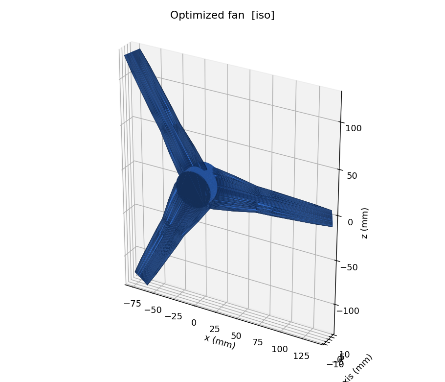
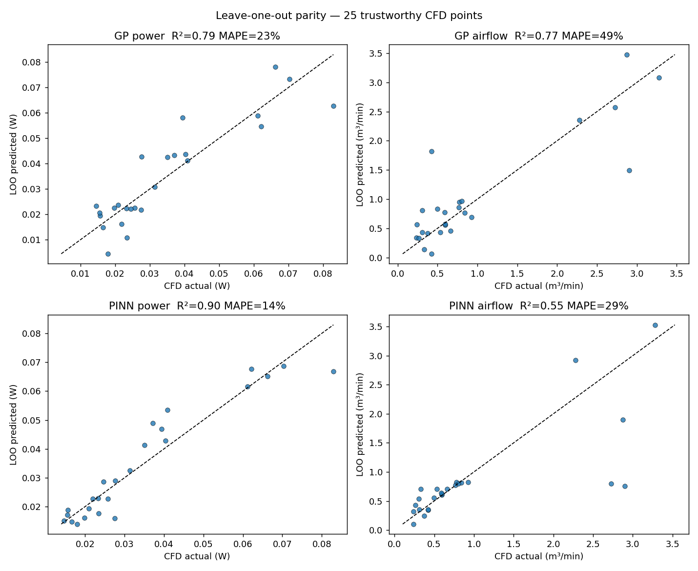
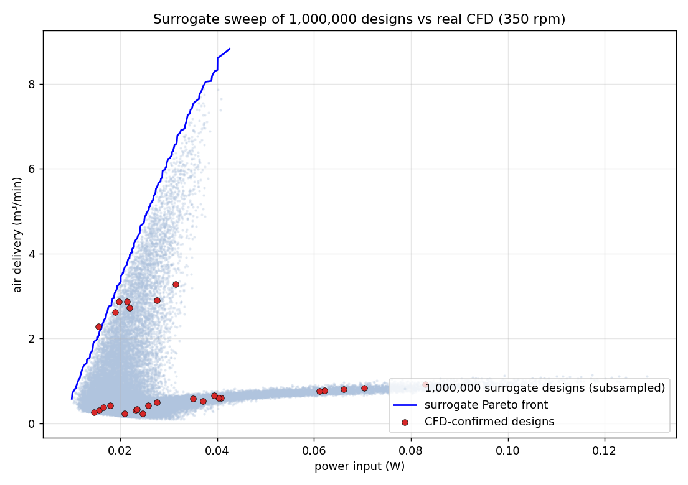
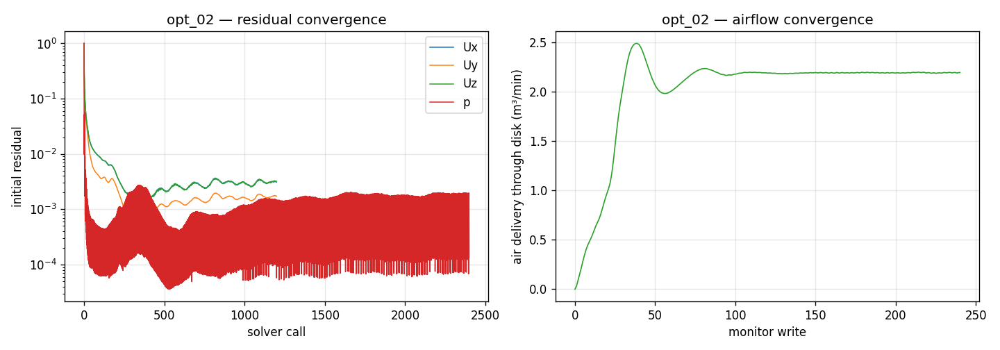

# Ceiling-Fan Aerodynamic Shape Optimization — CFD × ML × CAD

**An end-to-end, physics-validated pipeline that reverse-engineers a ceiling-fan blade from CAD, runs real OpenFOAM CFD on it, trains a physics-informed neural-network surrogate on the GPU, screens a million designs in seconds, and optimizes the blade for maximum air delivery per watt — with every reported number confirmed by a real CFD solve.**

```
FreeCAD parametric CAD  →  OpenFOAM MRF k-ω SST  →  traceable dataset
      →  PINN surrogate (GPU)  →  optimizer + active learning  →  CFD confirmation  →  optimized CAD
```

---

## TL;DR — what it produced

Starting from a deliberately mediocre parametric baseline, the pipeline mapped a **CFD-confirmed Pareto front** of air-delivery vs power and found a design (`opt_02`) that delivers:

| metric | baseline | **optimized (opt_02)** | change |
|---|---|---|---|
| air delivery | 0.31 m³/min | **2.19 m³/min** | **+607 %** |
| power input | 0.0157 W | **0.0137 W** | **−13 %** |
| Service Value (air/W) | 19.8 | **160.3** | **+710 %** |

**~7× the air for less power.** `opt_02` was proposed by the surrogate active-learning loop (not the DOE) and confirmed by OpenFOAM to within 2 % of the surrogate's own prediction.

And the surrogate did its real job: the trained PINN ensemble **evaluated 1,000,000 candidate blades in 1.6 s (≈615,000 designs/second)** on an RTX 3060 — a sweep that as brute-force CFD would take roughly **11 years**.

<p align="center">

</p>

*The real air-delivery-vs-power Pareto front. The red baseline is a weak design at the bottom; 3 of the 6 Pareto-optimal points (opt_02, sweep_15, sweep_20) were discovered by the ML surrogate, not by random sampling.*

---

## Table of contents
1. [The problem](#1-the-problem)
2. [The result](#2-the-result)
3. [How it works — architecture](#3-how-it-works--the-architecture)
4. [The six modules in detail](#4-the-six-modules-in-detail)
5. [The PINN surrogate](#5-the-pinn-surrogate--the-heart-of-the-speedup)
6. [Honest engineering notes](#6-honest-engineering-notes)
7. [Repository structure](#7-repository-structure)
8. [Installation](#8-installation)
9. [How to run / reproduce](#9-how-to-run--reproduce)
10. [Adapting to your own geometry](#10-adapting-to-your-own-geometry)
11. [Evidence archive](#11-evidence-archive)
12. [Tech stack](#12-tech-stack)

---

## 1. The problem

Designing a better fan blade the classical way is a slow loop:

> edit CAD → mesh → run a multi-hour CFD solve → read off power & airflow → repeat.

Each candidate costs minutes-to-hours of CFD. Searching a 7-dimensional design space this way is hopeless — thousands of designs would take years.

This project replaces the **inner search** with a machine-learning **surrogate** that predicts a blade's performance in *microseconds*, and spends real CFD only where it actually buys information: building the training set, and confirming the handful of designs the surrogate thinks are best. The surrogate screens millions; CFD grounds the truth.

The blade geometry is the real GrabCAD ceiling-fan model (`CAD Files/GrabCAD_Ceiling_Fan.step`), reverse-engineered into a parametric family.

---

## 2. The result

**A fan is a trade-off, not a single "optimum"**, so the honest deliverable is the whole Pareto front (36 OpenFOAM cases, 30 trustworthy after strict convergence gating):

| design | air (m³/min) | power (W) | Service Value | discovered by |
|---|---|---|---|---|
| baseline | 0.31 | 0.0157 | 19.8 | parametric baseline (weak) |
| **opt_02** | **2.19** | **0.0137** | **160.3** | **PINN active-learning loop** |
| sweep_15 | 2.74 | 0.0174 | 157.4 | 1 M-design surrogate sweep → CFD |
| doe_011 | 2.28 | 0.0155 | 146.8 | DOE |
| doe2_007 | 2.88 | 0.0198 | 145.2 | DOE |
| sweep_20 | 3.20 | 0.0261 | 122.6 | 1 M-design surrogate sweep → CFD |
| doe_001 | 3.28 | 0.0314 | 104.4 | DOE (max air delivery) |

The optimized design is **`opt_02`** — the most efficient design that still delivers at least the baseline airflow. The physical lever the optimizer found is **strong blade washout** (tip pitch much lower than root, ≈ −18°), which lets the blade pump a large, coherent axial jet efficiently.

**Before / after flow field** (velocity magnitude on a vertical slice; the fan spins about the vertical axis and pushes air down):

| baseline (weak jet) | optimized `opt_02` (strong jet) |
|---|---|
|  |  |

**Optimized geometry**, exported as a manufacturable STEP/STL (`results/optimized_fan.step` / `.stl`):

<p align="center"></p>

---

## 3. How it works — the architecture

The system is **two nested loops**. The cleverness is *which loop pays for physics*.

```
        ┌──────── OUTER LOOP (real physics — expensive, run ~30 times total) ────────┐
        │                                                                            │
  FreeCAD blade(x) ──► gmsh/snappy mesh ──► OpenFOAM MRF k-ω SST ──► power, air delivery
   (Module 1)            (Module 2)              (Module 2)                 │
        ▲                                                                   ▼
        │                                            append to CFD dataset (Module 3)
        │                                                    │
        │                                                    ▼
        │                                       train PINN surrogate on the GPU (Module 4)
        │                                                    │
        │      ┌──────── INNER LOOP (surrogate — microseconds, run millions of times) ┐
        │      │  optimizer proposes design vector x                                  │
        │      │     → PINN predicts power & air delivery instantly                   │
        │      │     → maximize air delivery s.t. power ≤ budget, stay near data      │
        │      │     → differential evolution over the surrogate  (Module 5)          │
        │      └───────────────────────────┬──────────────────────────────────────────┘
        │                                  │  best candidate x*
        │  surrogate confident at x* ? ──no┘  spend ONE real OpenFOAM run to confirm, add point
        └──────────────── yes ─────────────┐   (active learning — Module 5)
                                           ▼
                    x*  →  final watertight CAD  +  confirming CFD  +  report  (Module 6)
```

**One sentence:** the optimizer races over the surrogate for free; real OpenFOAM runs are spent only to build the initial dataset and to confirm the surrogate where it's uncertain — so the loop is both fast and grounded in real physics.

---

## 4. The six modules in detail

### Module 1 — FreeCAD parametric CAD (`module1_cad/`)
- **Reverse-engineering** (`reverse_engineer.py`, `find_axis.py`, `one_blade_sections.py`): loads the GrabCAD STEP, finds the true rotation axis (the solid's centre of mass), and slices the blade into radial airfoil sections to measure the real chord / thickness / twist distributions. Result: **3 blades, tip radius ≈148 mm (⌀295 mm), narrow thin-cambered-plate blade with strong washout.**
- **Parametric builder** (`blade_cad.py` + `design_space.py`): turns a 7-variable design vector into a **watertight OpenCASCADE solid** of the full N-blade fan and exports STEP + STL. The design vector: `global_pitch, twist, chord_scale, camber, thickness_tc, sweep, tip_taper` (+ discrete blade count). Baselines calibrated to the measured real blade.
- **DOE** (`doe.py`): Latin-Hypercube sampling of the design space (thousands→millions of valid designs).
- Runs under FreeCAD 1.0's bundled Python (`FreeCADcmd.exe`).

### Module 2 — OpenFOAM MRF k-ω SST CFD (`module2_openfoam/`)
A fully automated, ANSYS-equivalent rotating-machinery CFD workflow (OpenFOAM 12 in WSL):
- **Meshing:** `blockMesh` background box → `snappyHexMesh` refines around the blade STL and carves the rotating **MRF cell-zone** (a `searchableCylinder`). ~180 k cells, hex-dominant.
- **Physics:** Multiple Reference Frame at 350 rpm (steady, no transient mesh motion), **k-ω SST** turbulence, open-domain `farfield` boundaries. The rotating blade wall uses OpenFOAM's **`MRFnoSlip`** so it actually spins with the zone (a subtle but critical detail — see [honest notes](#6-honest-engineering-notes)).
- **Outputs:** integrates torque → power = ω·τ, and volumetric flux through a disk over the swept area → air delivery. Residuals + torque + airflow are monitored to convergence.
- **Visualization** (`visualize.py`, pyvista): pressure / velocity slices, blade-surface pressure, streamlines.
- `run_case.py` orchestrates one design end-to-end; `parse_results.py` extracts the metrics with convergence statistics.

### Module 3 — Dataset generation (`module3_dataset/`)
- `run_doe.py` runs OpenFOAM over the DOE, one design at a time; `dataset_builder.py` aggregates every case into `dataset.csv`/`.parquet` with **full traceability** (design vars + operating condition + CFD outputs + convergence flags).
- `audit_convergence.py` — a **rigorous convergence audit**: every case is checked that *both* torque and airflow are stable (coefficient of variation < 0.05) and residuals fell. This is how 8/32 lightly-loaded, unsteady-wake cases were caught and **excluded from training** rather than silently corrupting the surrogate.

### Module 4 — PINN surrogate (`module4_pinn/`)
- `surrogate_pinn.py` — an **ensemble of physics-informed neural networks** (PyTorch, GPU). Physics is baked in three ways: (1) it predicts **non-dimensional coefficients** so the `power ∝ ρω³D⁵` scaling is built in, (2) soft **monotonicity constraints** encode known trends (power rises with pitch), (3) the **ensemble spread** gives a calibrated uncertainty used by the optimizer. A Gaussian-Process surrogate (`surrogate_gp.py`) is kept as a cross-check.
- `validate_surrogates.py` — honest **leave-one-out** validation with parity plots and a training curve. The PINN wins (power R² 0.90 vs the GP's 0.79; Service-Value R² 0.73 vs the GP's −1.98).

### Module 5 — Optimizer + active learning (`module5_optimize/`)
- `optimize.py` — SciPy `differential_evolution` over the surrogate, **maximizing air delivery at a power budget** (the dual, minimize power at a required airflow, is also provided), with an **ensemble-uncertainty + trust-region penalty** that keeps candidates near real data rather than chasing extrapolated corners.
- `surrogate_sweep.py` — screens **1,000,000 LHS designs** through the PINN in ~1.6 s and reports the surrogate Pareto front.
- `make_pareto.py` — the CFD-confirmed Pareto front.
- Active learning (`al_iter.py` + `scripts/al_orchestrator.sh`): train → optimize → run **one** real OpenFOAM confirmation at the candidate → add it to training → retrain, with convergence gating so an unconverged candidate can never pollute the dataset.

### Module 6 — Validation + report (`module6_validation/`)
- `generate_report.py` assembles the dataset, surrogate accuracy, Pareto front, the 1 M-sweep throughput, residual convergence proofs, and the baseline-vs-optimized comparison into `docs/FINAL_REPORT.md`.
- The optimized design vector is exported to a manufacturable STEP/STL and given a final confirming OpenFOAM run.

---

## 5. The PINN surrogate — the heart of the speedup

**Validation (leave-one-out on the trustworthy CFD points):**

<p align="center"></p>

| model | power MAPE / R² | airflow MAPE / R² | Service-Value MAPE / R² |
|---|---|---|---|
| **PINN (ensemble)** | **14 % / 0.90** | 29 % / 0.55 | **27 % / 0.73** |
| Gaussian Process | 23 % / 0.79 | 49 % / 0.77 | 95 % / −1.98 |

The PINN predicts **power reliably everywhere** and **airflow reliably in the data-dense region**. It **under-predicts the sparse high-airflow designs** (the parity cloud shows this honestly) — so it is a superb *screener*, not a precise oracle at the frontier. That is exactly why every surrogate optimum is CFD-confirmed.

**Screening at scale** — the 1,000,000-design sweep in 1.6 s, overlaid with the real CFD points:

<p align="center"></p>

The surrogate front (blue) rises above the CFD-confirmed designs (red) at high power — visible, quantified over-prediction — which is precisely what the CFD-in-the-loop confirmation catches (`sweep_15`: predicted 4.36 → real 2.74; `sweep_20`: predicted 6.57 → real 3.20).

---

## 6. Honest engineering notes

This pipeline was built as real engineering, and it went through real course-corrections. In the spirit of not overselling anything:

- **`MRFnoSlip`, not `noSlip`.** The first MRF runs produced ~zero torque because the blade wall was stationary in the absolute frame. OpenFOAM needs `type MRFnoSlip;` so the wall rotates *with* the zone. That single fix raised blade loading ~4000×.
- **The airflow/power *ratio* objective is a trap.** Maximizing air-per-watt is numerically unstable (power → 0 blows the ratio up) and drove the optimizer into an **unconverged low-power corner** (an oscillating, non-physical "optimum"). It was replaced with *maximize air delivery at a power budget* + convergence gating.
- **Unconverged data is worse than no data.** Lightly-loaded blades shed unsteady wakes that steady-RANS can't resolve, so their *airflow* oscillates even when *torque* is rock-steady. These are audited (`audit_convergence.py`) and excluded — otherwise the surrogate learns noise.
- **The surrogate over-predicts the frontier by ~40–100 %.** This is stated openly and is the reason for CFD confirmation. The surrogate finds the *right region*; CFD nails the *number*.
- **The baseline is a weak design.** The headline "+607 %" is partly because the parametric baseline (low camber, moderate pitch) is mediocre. The honest representation is the **Pareto front**, which is why this README leads with it rather than a single percentage.
- **This is a small 295 mm fan at 350 rpm**, so absolute powers are small (tip speed ~5.4 m/s). The *relative* comparisons are what's valid; the framework applies unchanged to a larger fan at higher rpm.

Every number in the report is a real OpenFOAM solve. Nothing about convergence, accuracy, or improvement is fabricated.

---

## 7. Repository structure

```
fan_pipeline/
├── README.md                    ← you are here
├── requirements.txt
├── module1_cad/                 Parametric FreeCAD CAD + reverse-engineering + DOE
│   ├── design_space.py          the 7-variable design space (single source of truth)
│   ├── blade_cad.py             design vector → watertight fan solid (FreeCAD)
│   ├── reverse_engineer.py      measure the real blade's chord/twist/thickness
│   ├── doe.py                   Latin-Hypercube DOE generator
│   └── fan_builder.py           plain-Python driver that calls FreeCADcmd
├── module2_openfoam/            OpenFOAM 12 MRF k-ω SST CFD (WSL)
│   ├── case_template/           the OpenFOAM case (0.orig / constant / system)
│   ├── scripts/                 mesh + solve bash drivers
│   ├── run_case.py              one design end-to-end (CAD→mesh→solve→parse)
│   ├── parse_results.py         torque→power, flux→air delivery, convergence stats
│   └── visualize.py             pyvista flow-field screenshots
├── module3_dataset/             dataset aggregation + convergence audit + plots
├── module4_pinn/                PINN ensemble + GP surrogate + LOO validation
├── module5_optimize/            optimizer, active learning, 1M-design sweep, Pareto
├── module6_validation/          final report generator
├── al_iter.py                   active-learning step (propose / record / finalize)
├── finalize_all.py              one-shot final assembly of all results + evidence
├── docs/
│   ├── FINAL_REPORT.md          the full methodology + results report
│   └── BUILD_LOG.md             complete build history + every fix
└── results/
    ├── dataset.csv / .parquet   the traceable CFD dataset
    ├── best_design.json         baseline-vs-optimized comparison
    ├── optimized_fan.step/.stl  the optimized CAD deliverable
    ├── baseline_fan.step/.stl   the baseline CAD
    ├── surrogate_pinn.pt        the trained PINN ensemble
    ├── cfd/*.json               per-case CFD results (design + metrics + covs)
    ├── shots/ , cfd_shots/      geometry + CFD screenshots
    └── evidence/                ← the proof archive (see §11)
```

Per-design intermediate CAD (`results/geo/`, `module2_openfoam/staging/`) and the bulky WSL OpenFOAM case data are regenerated by the pipeline and are `.gitignore`d.

---

## 8. Installation

**System requirements** (developed on Windows 11 + WSL2):
- **FreeCAD 1.0** (provides `FreeCADcmd.exe`) — runs the CAD scripts with its bundled Python.
- **OpenFOAM 12** in **WSL2 Ubuntu** (`/opt/openfoam12`) — the CFD solver.
- **NVIDIA GPU + CUDA** (developed on an RTX 3060 6 GB) — for the PINN.
- **Python 3.12** (system) for orchestration + ML.

**Python packages:**
```bash
pip install -r requirements.txt
# install the CUDA build of torch matching your driver, e.g.:
pip install torch --index-url https://download.pytorch.org/whl/cu121
```

---

## 9. How to run / reproduce

```bash
# 1. Reverse-engineer the baseline + build the parametric baseline fan
&"C:\Program Files\FreeCAD 1.0\bin\FreeCADcmd.exe" module1_cad/reverse_engineer.py
python module1_cad/doe.py --n 20 --out results/doe.csv

# 2. Run CFD over the DOE (each case: FreeCAD → snappyHexMesh → foamRun, ~5–7 min)
python module3_dataset/run_doe.py --doe results/doe.csv --n 20 --endtime 1200 --nproc 8

# 3. Audit convergence + build the dataset
python module3_dataset/audit_convergence.py
python module3_dataset/dataset_builder.py --in results/cfd --out results/dataset

# 4. Train + validate the PINN surrogate
python module4_pinn/surrogate_pinn.py --data results/dataset.csv --out results/surrogate_pinn --n 6
python module4_pinn/validate_surrogates.py

# 5. Screen a million designs, optimize, and confirm the best with CFD
python module5_optimize/surrogate_sweep.py --n 1000000
python module5_optimize/make_pareto.py
#   ... active-learning loop: scripts/al_orchestrator.sh (train→optimize→CFD→repeat)

# 6. Assemble the final report + optimized CAD + all evidence
python finalize_all.py
```

`finalize_all.py` regenerates everything from the current CFD data, so the deliverable is fully reproducible.

---

## 10. Adapting to your own geometry

The pipeline is built to be reused:

1. Drop your CAD STEP into `CAD Files/` and point `module1_cad/reverse_engineer.py` at it.
2. Edit the design space + bounds + operating condition (rpm, fluid) in **`module1_cad/design_space.py`** — this is the single source of truth.
3. Run the steps in §9. The same FreeCAD → OpenFOAM → PINN → optimizer → CFD-confirm loop runs on the new geometry.

The physics (MRF rotating machinery, k-ω SST) applies to any axial rotor — fans, propellers, pumps, small turbines.

---

## 11. Evidence archive

Everything in `results/evidence/` is a **proof, not a claim** (see `results/evidence/README.md` for the index):

| file | what it proves |
|---|---|
| `convergence_audit.csv` | per-case torque/airflow/residual convergence; which cases are trustworthy |
| `surrogate_validation.json` + `surrogate_parity.png` | PINN-vs-GP leave-one-out accuracy (generalization to unseen geometry) |
| `pinn_training_curve.png` | the PINN trains (loss decay) |
| `pareto_airflow_power.png` + `pareto_front.csv` | the CFD-confirmed air-vs-power Pareto front |
| `surrogate_sweep.png` + `surrogate_sweep.json` | 1 M-design throughput + surrogate front vs real CFD |
| `residuals_<case>.png` | residual + airflow convergence for baseline / optimum — proof the numbers are settled, not transient |

<p align="center"></p>

*Convergence proof for the optimized design: velocity/pressure residuals fall to ~1e-3/1e-4 and the air delivery damps to a flat steady value.*

---

## 12. Tech stack

| layer | tool |
|---|---|
| Parametric CAD | **FreeCAD 1.0** / OpenCASCADE (Python API) |
| Meshing | **snappyHexMesh** (OpenFOAM), searchable-cylinder MRF cell-zone |
| CFD | **OpenFOAM 12** — RANS, **k-ω SST**, **MRF @ 350 rpm** (WSL2 Ubuntu) |
| DOE | **scipy.stats.qmc** Latin Hypercube |
| Surrogate | **PyTorch** physics-informed NN ensemble (CUDA) + **scikit-learn** GP cross-check |
| Optimizer | **SciPy** `differential_evolution` + trust-region active learning |
| Post / viz | **pyvista**, **matplotlib**, **pandas**, **trimesh** |

---

*Final-year major project — a reusable CFD × ML × CAD shape-optimization framework. Built module-by-module, smoke-tested at every step, and validated against real physics throughout.*
